# The OPUS database design

**Scope:** the MySQL schema `opus_import` builds and `opus_app` serves, as the
performance plan (`plans/2026-10-27_database_performance_plan.md`) leaves it, and the
reasons for each departure from the schema in the tree at `2179d937`. The analysis that
motivates it is `critiques/2026-10-27_database_format_analysis.md`. Nothing here is
PostgreSQL-specific; the optional port described in the plan carries this same shape.

**Date:** 2026-10-28.

The design in one paragraph: `obs_general` stays the hub, one row per observation, and
every other `obs_*` table hangs off it on the hub's integer id and nothing else. The
things that are tables today because of a data value or a unit of work become rows: a
surface geometry target is a value in one table, not a table of its own; a search is a
set of rows in one shared results table, not a table of its own; a page is a range of
those rows, not a temporary table. Indexes are built once, after the load, by sort, and
composite where a query shape needs one. Every piece of per-user and per-search state
lives in the database, so any worker can serve any request.

---

## 1. Motivations

Five properties of the current schema drive the design.

**Units of work are units of DDL.** A search creates a table, a page creates a temporary
table, and the import creates a table for every target body it meets. DDL serializes on
the data dictionary, commits any open transaction, churns the table cache, and leaves an
unbounded number of tables behind. Over a network, each one is also a round trip. The
design removes DDL from the request path entirely and from the import's inner loop.

**Every row is written twice into fully indexed tables, with two foreign keys checked per
row.** The import writes a bundle into import-namespace copies of the tables, then copies
it into the permanent tables, and both sets carry every index the schema declares plus a
foreign key on both `obs_general_id` and the 50-character `opus_id`. The design writes a
fresh schema once, with only its primary and unique keys, and builds the rest afterward.

**Nearly every column is its own index and no query shape has a composite one.** The
default sort, the angular pairs, and the per-target searches each read more pages than a
composite index would. The design adds the composites the measured shapes need and prunes
nothing until production index-usage statistics exist.

**Data values are table names.** About a hundred `obs_surface_geometry__<target>` tables
exist because each target body got a table. Every one is a Django model class, so a
target the deployed code has never seen cannot be served until the models are regenerated
and the application is redeployed. The design keeps the per-target *categories*, which
the public API exposes, as data, and stores the rows in one table.

**Lookup values are one table per column, ordered by a string.** Each enumerated column
has its own `mult_` table and Django model. Its display order is a string computed once,
when a value is first seen, so it depends on the order bundles were imported and sorts
negative numbers wrongly, and a value whose observations are deleted stays in the search
form. The design keeps one table with an integer rank recomputed at the end of every
import, and removes values nothing references.

---

## 2. The schema

The tables and how they relate. `obs_mission_x` and `obs_instrument_x` stand for the
per-mission and per-instrument tables, which keep their shape apart from the key change
of §2.2. Row counts and sizes are left out on purpose: the plan states a number only when
its harness has measured it.

```mermaid
erDiagram
  obs_general ||--o| obs_pds : "obs_general_id"
  obs_general ||--o| obs_ring_geometry : "obs_general_id"
  obs_general ||--o| obs_wavelength : "obs_general_id"
  obs_general ||--o| obs_mission_x : "obs_general_id (one per mission)"
  obs_general ||--o| obs_instrument_x : "obs_general_id (one per instrument)"
  obs_general ||--o| obs_surface_geometry : "obs_general_id"
  obs_general ||--o{ obs_surface_geometry_target : "obs_general_id"
  obs_general ||--o{ obs_files : "obs_general_id"
  obs_general ||--o{ obs_general_target_name : "obs_general_id"
  obs_general ||--o{ obs_general_target_class : "obs_general_id"
  obs_general ||--o| obs_preview : "obs_general_id (gated)"
  mult_field ||--o{ mult : "field_id"
  mult_field ||--o{ mult_group : "field_id"
  mult ||--o{ obs_surface_geometry_target : "target_name = mult id"
  mult ||--o{ table_names : "target_name (category rows)"
  user_searches ||--o{ search_results : "search_id"
  obs_general ||--o{ search_results : "obs_general_id"
  table_names ||--o{ param_info : "category_name"
  table_names ||--o{ partables : "partable"

  obs_general {
    uint id PK
    char50 opus_id UK
    char75 bundle_id "key; the per-bundle steps join on it"
    real8 time1 "key (time1, opus_id)"
    real8 right_asc "key (right_asc, d_right_asc)"
    real8 declination1 "key (declination1, declination2)"
    json target_name "mult_list, kept for rendering"
    json target_class "mult_list, kept for rendering"
  }
  obs_pds {
    uint obs_general_id PK "FK added in finalization"
    char50 opus_id "public opusid field, plain key"
    char75 bundle_id "public bundleid field, plain key"
  }
  obs_surface_geometry_target {
    usmallint target_name PK "mult id; PK (target_name, obs_general_id)"
    uint obs_general_id PK "key (obs_general_id)"
    real8 planetographic_latitude1 "key (target_name, col) per keyed column"
  }
  obs_files {
    uint id PK
    uint obs_general_id FK
    char50 opus_id "kept: file_utils reads it"
    char60 instrument_id "kept"
  }
  obs_general_target_name {
    usmallint mult_id PK "PK (mult_id, obs_general_id)"
    uint obs_general_id PK "key (obs_general_id)"
  }
  search_results {
    uint search_id PK "PK (search_id, sort_order)"
    uint sort_order PK
    uint obs_general_id "UK (search_id, obs_general_id); the cart range editor probes it"
  }
  user_searches {
    uint id PK
    binary32 search_hash UK "SHA-256 of the canonical search"
    uint result_count
    datetime results_built_at
    datetime last_used_at "refreshed daily; the pruner reads it"
  }
  table_names {
    char60 table_name "category name, as the API shows it"
    char60 physical_table "NULL, or obs_surface_geometry_target"
    uint target_name "NULL, or the target's mult id"
  }
  schema_version {
    uint version PK
    enum state "ready or appending"
    json appending_bundles "set while appending"
    datetime started_at
  }
  mult_field {
    usmallint field_id PK
    varchar100 qualified_name "UK; e.g. obs_general.planet_id"
    tinyint pinned "the schema lists the choices"
  }
  mult {
    usmallint field_id PK "PK (field_id, id)"
    usmallint id PK
    varchar100 value "UK (field_id, value); '' for absent, never NULL"
    varchar100 label
    usmallint pin "optional fixed position"
    usmallint disp_rank "recomputed every import"
    enum display
    varchar100 grouping
  }
  mult_group {
    usmallint field_id PK "PK (field_id, grouping)"
    varchar100 grouping PK
    usmallint group_pin
    usmallint group_rank
  }
```



### 2.1 The hub

`obs_general` keeps its shape: `id` is the primary key and `opus_id` the unique key. It
gains composite keys for the query shapes that read it in order or by pair:

| Key | Serves |
|---|---|
| `(time1, opus_id)` | the default sort; with the clustered key appended it covers `SELECT id ... ORDER BY time1, opus_id` |
| `(right_asc, d_right_asc)` | the right ascension predicate, as a covering scan (the angular predicate is a modular expression and cannot be range-scanned) |
| `(declination1, declination2)` | the declination predicate, as an index range on `declination1` with `declination2` read from the index |

`obs_ring_geometry` gains the same kind of key, `(<col>, d_<col>)`, for each of its longitude
pairs, a covering scan for the same modular predicate.

The two JSON list columns, `target_name` and `target_class`, stay for rendering responses.
Searching and counting on them move to junction tables (§2.5). The `preview_images` JSON
column moves to a one-to-one `obs_preview(obs_general_id, preview_images)` table only if
the measured ratio of its storage to the table's data length exceeds one quarter;
otherwise it stays.

**The import finds a bundle's rows through `obs_general` alone**, by its `bundle_id`
key. `obs_pds` also stores `bundle_id`, because it is the public `bundleid` field (§2.2),
and the import writes both from the same bundle; validation checks that they agree. Every
other table the import writes per observation (the remaining children, the junction tables
of §2.5, `obs_preview`, and the surface geometry table) reaches its bundle through
`obs_general_id`, so the per-bundle delete, the incremental copy, and the seed of §3.1
join each table to `obs_general`'s bundle key, and the duplicate OPUS id delete uses the
`obs_general_id` it resolves. No table carries a 75-character column and an index for the
import's sake. `search_results` and `cart` also carry `obs_general_id` but are not
imported: the import resets `search_results` (§2.4) and re-creates `cart` empty (§3).

### 2.2 The children

Every per-category `obs_*` table is keyed on the hub:

- `obs_general_id` is the primary key. The surrogate `id` goes; a child has exactly one
  row per observation, so the join key is the row locator and every child join is a
  unique lookup on the clustered index.
- The foreign key on `opus_id` goes, and so does the column, along with the copied
  `instrument_id`, and the copied `bundle_id`. Two exceptions: `obs_pds` keeps `opus_id`
  and `bundle_id` as plain keyed columns because they are the public `opusid` and
  `bundleid` fields, shown on result pages and searched, and `obs_files` keeps `opus_id`
  and `instrument_id` (below).
- A bundle's rows in a child are found by joining `obs_general` on `obs_general_id`
  (§2.1); the join is a range on `obs_general`'s bundle key followed by primary-key
  lookups in the child.
- The one foreign key, `obs_general_id → obs_general.id`, is declared at table level in
  the schema file and added in finalization, not at creation.

`obs_ring_geometry` additionally gets a composite key per longitude pair.

`obs_files` is the one child with many rows per observation. It keeps its own `id`,
`obs_general_id`, `opus_id` (the file logic reads by it), and `instrument_id`. Its
secondary indexes are `(opus_id, short_name, version_name)` for the file reads and
`(obs_general_id)` for the download join, and nothing else; it is the largest table by
rows, and each unused index is a full extra copy of a key column.

### 2.3 Surface geometry

One physical table replaces the per-target tables and the selector table, which is the
shape #334 asks for:

```sql
obs_surface_geometry_target(
  target_name     SMALLINT UNSIGNED NOT NULL,  -- mult id (§2.8)
  obs_general_id  INT UNSIGNED NOT NULL,
  <every geometry column of the template>,
  PRIMARY KEY (target_name, obs_general_id),
  KEY (obs_general_id),
    KEY (target_name, <col>)  -- one per keyed column of the template
  KEY (target_name, <X1>, <X2>)  -- one per displayed range pair, index-only
)
```

**Target first in the primary key**, so one target's rows are contiguous in the clustered
index as they are in a per-target table today. A two-column range search (`X1 <= max AND
X2 >= min`) uses the `(target_name, X1)` index and then probes the clustered row for
`X2`; with the observation first, each observation's several targets would interleave and
multiply the cold page reads by the mean number of targets per observation. The alias
join below is still a unique lookup, and the per-observation lookup is a covering dive on
the secondary key, which also serves the foreign key and the per-observation delete.

`target_name` is the target's id within the selector's mult field,
`obs_surface_geometry_name.target_name` (§2.8), so every target has an id, a label, a
rank, and a grouping there. The template's column names that field with a `mult_field`
key, because the column's own qualified name would name a different field.

**The categories stay as data.** `table_names`, `param_info`, and `partables` keep one
row per target (and per column, for `param_info`) with exactly today's names, labels,
slugs, and display orders, so `api/categories` keeps returning
`obs_surface_geometry__saturn` and every slug keeps its `SURFACEGEO<target>_` prefix.
`table_names` gains two columns:

| Column | For a category that is its own table | For `obs_surface_geometry__<target>` | For `obs_surface_geometry_name` |
|---|---|---|---|
| `physical_table` | `NULL` | `obs_surface_geometry_target` | `obs_surface_geometry_target` |
| `target_name` | `NULL` | the target's mult id | `NULL` |

The selector category `obs_surface_geometry_name` therefore survives as a row that points
at the one table with no target filter. Its predicate is a semi-join (`EXISTS` on
`obs_surface_geometry_target` for the selected targets), never a join, so selecting several
targets cannot duplicate an observation. Its field keeps the qualified name
`obs_surface_geometry_name.target_name`, which the form, the trigger logic, the mult-table
naming helper, the base-table list, and the menu code all spell out, and the mult table
keeps its name. Nothing hard-coded moves.

**Resolution in the application** is one function: a category resolves to a model, a
physical table, and an optional target id, from `table_names`. In SQL the category name
becomes the join alias:

```sql
LEFT JOIN obs_surface_geometry_target AS obs_surface_geometry__saturn
       ON obs_general.id = obs_surface_geometry__saturn.obs_general_id
      AND obs_surface_geometry__saturn.target_name = ?
```

so every column reference written as `category.column` is already correct, and a search
naming two targets joins the table twice under two aliases, as two tables did. Every site
that uses a category as a `FROM` source or a model (mult counts, range endpoints,
metadata, the per-observation lookup) goes through the same function, and the range
endpoints filter by target in both of their branches so that one target's endpoints are
never the union of all.

The import derives the target list from `SELECT DISTINCT target_name` over the data and
writes the category rows with the same labels, order, and slugs as today. Rows are
computed under the category name, so the per-target validation keeps running, and written
to the one table; on both the metadata-index and the inline path, the row's target string
is resolved to its id in the selector's mult field before the row is written. Two rows of
one observation that resolve to the same target write one row, the first in the import's
row order (sorted raw names on the summary-file path, file order on the inline path), with
a warning. A row whose target is unknown is not written.

**What a new target costs:** one mult row and its `table_names`, `partables`, and
`param_info` rows, written by finalization. No table is created, no model is generated,
nothing is redeployed; the worker restart that already follows every import refreshes
the per-process category caches. `models.py` loses about a hundred classes. Choosing a
target in Select Metadata (#651) becomes a change to the user interface alone.

`obs_surface_geometry`, the per-observation `target_list` text, keeps its shape.

### 2.4 Search results

One permanent, unpartitioned table replaces the per-search `cache_NNN` tables and the
per-page temporary tables:

```sql
search_results(
  search_id       INT UNSIGNED NOT NULL,
  sort_order      INT UNSIGNED NOT NULL,
  obs_general_id  INT UNSIGNED NOT NULL,
    PRIMARY KEY (search_id, sort_order),
  UNIQUE KEY (search_id, obs_general_id)
)
```

`user_searches` holds one row per distinct search and nothing it does not use:

```sql
user_searches(
  id               INT UNSIGNED NOT NULL AUTO_INCREMENT PRIMARY KEY,
  search_hash      BINARY(32)   NOT NULL,  -- SHA-256 of the canonical search
  result_count     INT UNSIGNED NULL,
  results_built_at DATETIME     NULL,
  last_used_at     DATETIME     NOT NULL,
  UNIQUE KEY (search_hash)
)
```

`search_hash` is one SHA-256 over the canonical selections, query types, units, and
order, with `null` for an absent part, so two requests share a row exactly when they
are the same search. The unique key is 32 bytes and is what makes two workers racing
to register the same search safe: the loser's insert fails and it reads the winner's
row. The memcached entry that maps a search to its id is keyed by the same hash in
hexadecimal, so its key has a fixed length whatever the search.

A page is `sort_order BETWEEN a AND b` on the join, exact because `ROW_NUMBER()` is dense.
The count is stored once. Partitioning is not used: `search_id` is the primary-key prefix,
so every per-search read is one range regardless. The unique key serves the cart's range
editor, which resolves an observation's position within a search, and makes a join that
duplicates an observation fail rather than repeat it on a page; every alias join in the
build is one row per observation. A `default_rank` column on `obs_general`, the position
in the default sort, which would let the empty search page without a build, is evaluated
on full-scale data at the end of the plan and added only if it measures a clear gain.

**Old searches are pruned, least recently used first** (#350). `last_used_at` is
refreshed at most once a day per search, from the cached entry, and skipped while the
search is being built, so it costs no write per request and never waits on the row lock. A
scheduled command deletes a search unused for a set number of days: its cache entry first,
then its `user_searches` row, so a new request registers it afresh, then its result rows
in chunks. Every request reads the search's count and build time from `user_searches` by
primary key, so a cached id whose row is gone is a miss, not a short page; only the
hash-to-id entry is cached, and ids are never reused within a schema. The same command
removes expired sessions and the carts whose session is gone. InnoDB reuses the freed
pages, so regular pruning bounds the table's size however long a schema is served.

```sql
SET innodb_lock_wait_timeout = <search_build_timeout>   -- from init_command
SET TRANSACTION ISOLATION LEVEL READ COMMITTED
BEGIN
  SELECT results_built_at FROM user_searches
    WHERE id = ? FOR UPDATE      -- the serialization point
  INSERT INTO search_results
    SELECT ?, ROW_NUMBER() OVER (ORDER BY ..., obs_general.id), obs_general.id
    FROM obs_general LEFT JOIN ...
  UPDATE user_searches
    SET result_count = ?, results_built_at = NOW()
COMMIT                            -- releases the row lock
```

**The build runs once per search however many requests race for it.** Registration
commits on its own first, because a failed duplicate insert holds a shared lock until its
transaction ends. Then, inside one `READ COMMITTED` transaction, so the `INSERT ...
SELECT` takes no shared locks on the rows it reads, the builder reads the search's own
`user_searches` row `FOR UPDATE`; a second builder blocks on that row until the first
commits, then sees `results_built_at` set and returns. If the row is unbuilt the builder
inserts `SELECT ?, ROW_NUMBER() OVER (ORDER BY ...), obs_general.id FROM ...`, writes the
count and the timestamp, and commits, which releases the lock. The transaction contains
nothing before the locking read, and the result rows are read after it commits, so a
`REPEATABLE READ` snapshot can never predate the build. A row lock is transaction-scoped:
a worker that dies releases it with its rollback, it is the same statement on both brands,
and it works through any connection pooling. The lock wait timeout is the session's
`innodb_lock_wait_timeout`, set from `[django] search_build_timeout` (default 300 seconds)
through the connection's `init_command`, long enough for a broad cold build and at least
30 seconds below the web server's worker timeout, since a worker killed mid-build rolls
the build back. A waiter whose wait times out ends its transaction and answers with the
search-cache failure response; the build it waited on completes, and the next request
finds it.

The application's cache trusts its entries (a hash-to-id or id-to-count hit is not
re-verified), so **every reset of these two tables is followed by a cache flush**: the
import's reset step runs the application's cache flush, the deploy restarts the cache
service after it, and the benchmark harness restarts the cache it owns. Without the flush, an
entry that outlived a truncate would hand one search's rows to another once ids restart.

The cost model is stated so the right thing is measured: the build is the same sort and
the same number of inserts, now into a shared table with a secondary unique index, so the
cold build itself is expected no faster. The gains are no DDL in the request path, a
bounded table count, the stored count, and one build per search under concurrency.

If the measured re-sort number still warrants it, `user_searches` gains a second hash
over the set alone, so a re-sort of a built set reorders its ids instead of
re-evaluating the predicate.

### 2.5 Junction tables for the list columns

Each JSON list column on `obs_general` gets a junction table written by the import from
the resolved mult ids; both are children in the sense of §2.2, with the foreign key to
`obs_general` added in finalization:

```sql
obs_general_target_name (mult_id, obs_general_id,
                         PRIMARY KEY (mult_id, obs_general_id), KEY (obs_general_id))
obs_general_target_class(the same shape)
```

A target search becomes a semi-join on the junction; the mult count, today a
`JSON_TABLE ... GROUP BY` over the whole result set, becomes a `GROUP BY mult_id` on the
junction joined to `search_results`. The JSON column stays for rendering. A
multi-valued JSON index is not used: it would serve the search but not the count.

### 2.6 Autocomplete

The string columns the autocomplete endpoint searches whose declared width is 100
characters or less get an ngram `FULLTEXT` key beside their B-tree, declared at table level
in the schema; the longer columns, file paths and notes, keep `LIKE`, since an ngram index on
them would outweigh the table. The query uses a quoted boolean
`MATCH ... AGAINST` for the `contains` type and prefixes of two or more characters, and
falls back to `LIKE` for one character, for the other types, and for any column where a
fixture comparison shows the two disagree. The stopword filter is off for the session
that builds the index, because the default list would drop every bigram containing `a`
or `i`.

### 2.7 Schema version

`schema_version(version INT UNSIGNED NOT NULL PRIMARY KEY, state ENUM('ready',
'appending') NOT NULL, appending_bundles JSON NULL, started_at DATETIME NULL)`, one row.
It is written, as `ready`, by an explicit final import step that writes only when the row
is absent and refuses to overwrite a different value; scorched earth deletes it, and an
append (§3) holds it at `appending` while it runs. The web application checks it at
startup and serves 503 on a mismatch, a missing row, or a state other than `ready`; both
deploy scripts check the served schema's row before running any import or migration step.
A half-built schema therefore cannot be served or promoted, and new code cannot stamp an
old schema.

### 2.8 Mult values

One table holds every enumerated value, in place of one `mult_<table>_<column>` table per
column:

```sql
mult_field(field_id       SMALLINT UNSIGNED PRIMARY KEY,
           qualified_name VARCHAR(100) NOT NULL UNIQUE,  -- e.g. obs_general.planet_id
           pinned         TINYINT NOT NULL)              -- the schema lists the choices
mult_group(field_id       SMALLINT UNSIGNED NOT NULL,
           grouping       VARCHAR(100) NOT NULL,
           group_rank     SMALLINT UNSIGNED NOT NULL,
                      group_pin      SMALLINT UNSIGNED NULL,
           PRIMARY KEY (field_id, grouping))
mult(field_id  SMALLINT UNSIGNED NOT NULL,
     id        SMALLINT UNSIGNED NOT NULL,  -- from 1; 0 is never valid
     value     VARCHAR(100) NOT NULL,       -- '' for the absent value
     label     VARCHAR(100) NOT NULL,
     pin       SMALLINT UNSIGNED NULL,
     disp_rank SMALLINT UNSIGNED NOT NULL,
     display   ENUM('Y','N') NOT NULL,
     grouping  VARCHAR(100) NULL,
     PRIMARY KEY (field_id, id),
     UNIQUE KEY (field_id, value))
```

- **Ids are per field**, so an observation column holds a small id: `SMALLINT UNSIGNED` in
  every mult column, the junction tables, and `obs_surface_geometry_target.target_name`,
  provided the largest field fits, which the plan checks against real data first. A label
  is a primary-key lookup, `JOIN mult AS m ON m.field_id = ? AND m.id = obs.column`. A
  column can name another column's field with a `mult_field` key, as the surface geometry
  table does for the selector (§2.3).
- **`disp_rank` is a dense integer per field**, computed for the whole field at the end of
  every import from typed values: pinned values first in `pin` order (pins come from the
  schema's option lists, from an observation class, or from `mult_overrides`); then
  ordinary values, numerically (the stored value through the column's unit parser when it
  has a unit, otherwise the label as a number) when every one parses and otherwise by
  case-folded label; then `Yes` and `On`; then `No` and `Off`; then the absent-value
  labels, compared case-folded, in the order `None`, `N/A`, `NULL`. Label and stored value
  break ties. The rank does not depend on the order bundles were imported, sorts negative
  numbers correctly, and is the same integer the search form and the counts sort by.
  Groups are ranked in `mult_group` by `group_pin` then case-folded name, so the planet
  groups keep their configured order. The absent value is stored as the empty string,
  never NULL, because a unique key does not deduplicate NULLs; a value outside a pinned
  field's list fails the bundle.
- **Values no observation references are deleted** at the end of every import, full or
  incremental, except in a pinned field, whose list is the intended set of choices. The
  search form therefore offers only values that return results.
- A value keeps the label, display flag, and grouping it was first stored with; an import
  that computes different ones logs a warning naming both.
- **Renaming a value needs no re-import.** A column's schema entry may list
  `mult_overrides`, each naming a value and any of its label, display flag, grouping,
  and pin. Overrides win over stored and computed labels; finalization applies them in
  every import, and the code-only deploy applies them to the served schema in place,
  then restarts the cache and the workers. Ids never change, so no observation row is
  touched.
- **Search results sorted by a mult column are ordered by label text**, not by
  `disp_rank`. That is the public API's ordering and stays as it is.
- The `aliases` and `timestamp` columns of today's tables are not carried: nothing reads
  them.

Two tables are evaluated on full-scale data at the end of the plan, and are added only
if the measurements, once discussed, justify them: `mult_count_empty(field_id, mult_id,
count)`, the counts for the empty search; and `obs_facet`, one narrow row per
observation holding every mult id, which a count over a large result set would scan
instead of the child tables.

### 2.9 Column types

- **Strings are `VARCHAR`**, never padded `CHAR`.
- **Identifier columns are ASCII with a case-insensitive collation** (`ascii_general_ci`,
  not a binary one: the `opusid` search field and the metadata URL take ids people type, and
  case must never matter there):
  every `opus_id` and `bundle_id` column, in `cart` and `obs_files` as in the observation
  tables, `obs_files.instrument_id` (the only string `instrument_id`), and the
  string-search columns whose values are all ASCII, so a join between two of them compares
  like with like. Comparisons are cheaper and sort keys a quarter the size of `utf8mb4`'s.
  Case never matters in a lookup. Rows that tie on every sort key are ordered by
  `obs_general.id`, appended as the final sort term, so every order is total. Labels, mult
  values, the dictionary, and free text stay `utf8mb4`.
- **No row timestamps.** Nothing reads them.
- **`cart.session_id` fits Django's session key**, and the cart's foreign key cascades
  a deleted observation's rows away.

### 2.10 Key changes at a glance

| Table | Key | Change | Why |
|---|---|---|---|
| `obs_general` | `(time1, opus_id)` | added | the default sort, covering with the primary key appended |
| `obs_general` | `(right_asc, d_right_asc)`, `(declination1, declination2)` | added | a covering scan for the modular right ascension predicate; an index range for declination |
| `obs_ring_geometry` | `(<col>, d_<col>)` per longitude pair | added | the same, for the ring longitude pairs |
| every child `obs_*` | `PRIMARY KEY (obs_general_id)` | replaces `id` | the join key is the row locator; one unique lookup per child |
| every child `obs_*` | `FOREIGN KEY (opus_id)`, the `bundle_id` key | removed | a second 50-character key checked on every write and never used for a join; bundles are found through `obs_general` |
| every child `obs_*` | `FOREIGN KEY (obs_general_id)` | added in finalization | created without, added once, so the load pays no per-row check |
| `obs_surface_geometry_target` | `PRIMARY KEY (target_name, obs_general_id)`, `KEY (obs_general_id)` | new | per-target locality; per-observation lookup as a covering dive |
| `obs_surface_geometry_target` | `(target_name, <col>)` per keyed column, `(target_name, <X1>, <X2>)` per displayed range pair | replaces about a hundred `KEY (col)` per column | one tree per column instead of one per target per column; the range pairs index-only |
| `obs_general_target_name`, `_class` | `PRIMARY KEY (mult_id, obs_general_id)`, `KEY (obs_general_id)` | new | semi-join for the search; grouped join for the counts |
| `mult` | `PRIMARY KEY (field_id, id)`, `UNIQUE (field_id, value)` | replaces one table per column | a label is a primary-key lookup; one model instead of ninety |
| `search_results` | `PRIMARY KEY (search_id, sort_order)`, `UNIQUE (search_id, obs_general_id)` | new | a page is one range; a position lookup is a probe |
| `user_searches` | `UNIQUE (search_hash)` | replaces the four-hash constraint | one 32-byte key per registration |
| autocomplete string columns | `FULLTEXT ... WITH PARSER ngram` | added | substring search without a scan; the B-tree stays |
| `obs_files` | `(opus_id, short_name, version_name)`, `(obs_general_id)` | replace six single-column keys | the file reads and the download join, and nothing else |

### 2.11 What does not change

The rows and columns of `partables`, `param_info`, and the dictionary tables (their string
types and row timestamps follow §2.9), `cart` beyond what §2.9 states, and the public API's
response bodies, including the order of results sorted by a mult column.

---

## 3. How the schema is built

The import writes every table directly; there is no import namespace and no copy. What
it does is chosen by the target schema's state, never by a command-line switch, and the
import logs which it chose, for which schema and version:

| Target schema | The import |
|---|---|
| No version row and no secondary indexes: empty, or a build still in progress | **builds**: steps 2 to 5 below |
| A version row that matches the code, `ready` | **appends** (below) |
| A version row that matches the code, `appending` | **resumes the append** |
| A version row from another release | refuses, naming both versions |
| No version row but secondary indexes: an interrupted finalization | refuses `--import`; a finalization-only invocation resumes it |

A full import runs one invocation per bundle group, and every one after the first finds a
build in progress and continues it. The bundle steps are chosen by this state; finalization
is an explicit step that the sequences run once at the end.

1. **Scorched earth** drops the `obs_` tables, the three mult tables, and `cart`, and
   deletes the `schema_version` row.
2. **Per bundle**, tables are created with their primary key and unique keys only, and
   `obs_general` with its bundle key too, which the per-bundle delete reads. Worker
   processes turn index rows into table rows; the parent process alone assigns ids,
   resolves mult values, and loads tab-separated text with `LOAD DATA LOCAL INFILE` in
   chunks of about 100,000 rows, failing on any skipped row or warning (the statement
   would otherwise ignore duplicate keys silently). Each bundle is deleted from the
   permanent tables before it is written, so a rerun is clean, and an OPUS id already
   written by an earlier bundle is deleted and re-imported.
3. **Aux tables** (`param_info`, `partables`, `table_names`) are rebuilt, with the surface
   geometry categories derived from the data, each into a shadow table that one `RENAME
   TABLE` swaps in atomically, so no reader ever finds one missing or half filled (the
   swap connection sets a short `lock_wait_timeout` and retries, since the rename waits
   for open transactions on those tables); `user_searches` and `search_results` are reset
   and the cache flush of §2.4 follows.
4. **Finalization** builds, by sort: `FULLTEXT` keys first, each in its own statement
   (the first one rebuilds its table); then B-tree indexes concurrently across tables,
   grouped per table within a temporary-space budget; then foreign keys serially under
   `foreign_key_checks = 0`; then the mult step, which deletes values nothing references
   and recomputes every rank (§2.8); then `ANALYZE` with histograms on the
   range-searched columns. The step is idempotent, comparing existing keys by kind and
   ordered columns.
5. **The dictionary import, validation, and the version row.** The dictionary's two tables
   are swapped together in one statement, `definitions__new` created with its foreign key
   pointing at `contexts__new`, so the key lands on the new `contexts`. Validation
   includes an orphan count per child, because finalization's foreign keys never validate
   existing rows.
6. **Promotion**, for a full import and an incremental update alike: the web service
   stops, the previous schema's sessions and carts are carried over into the new schema
   (unexpired `django_session` rows, and the `cart` rows of those sessions by `opus_id`,
   which `cart` already stores, to the observation's new `obs_general_id`; a cart row
   whose session expired or whose observation is gone is dropped and counted), the
   installation switches to the new schema, and the web service starts. The carry-over
   truncates its two target tables first, so it can run in either direction. If it fails,
   the web service is started again on the unchanged installation and the deploy exits
   non-zero; nothing has switched.

**Appending** adds or replaces bundles in a finalized schema that is not being served, the
way a developer adds a bundle to a deployed database. It exists because the configuration
names one schema: seeding a new schema for every iteration would mean editing the
configuration each time, so the append keeps the schema name fixed and changes the rows in
place. The import first sets the version row's state to `appending` and records the
bundles in `appending_bundles` and the time in `started_at`; new worker processes refuse
the schema and the deploy scripts refuse to promote it, while workers already running are
not stopped, because the version check runs once per worker at startup and nowhere else,
which is why an append is only for a schema that is not being served. Each bundle is
deleted and reloaded with the indexes and foreign keys in place; then every finalization
step an append invalidates runs again (the mult step, the aux tables, the search-table
reset with its cache flush, `ANALYZE`, and validation), and the state returns to `ready`.
A failed append stays `appending`; the next import resumes the recorded bundles plus any
it names, and since each bundle is deleted before it is written, the rerun is clean. An
append is not atomic, so it is never run against a schema that is being served; §3.1 is
how a served schema is updated.

### 3.1 Incremental update

An incremental update replaces a bundle with a new copy, adds a bundle, or drops one. A
browser sees nothing of it until it is finished, and then sees all of it at once. The
update is built as a new schema and promoted whole, exactly as a full import is:

1. **Seed.** The import, given `--clone-from-schema <served>` on an empty target, creates
   the tables as step 2 does and copies the served schema's rows into them, refusing when
   the served schema's version differs from the code's: `obs_general` with `WHERE
   bundle_id NOT IN (<the bundles being replaced, and those the existing
   --delete-permanent-bundles names for dropping>)`, every other per-observation table
   with `WHERE obs_general_id NOT IN (SELECT id FROM <served>.obs_general WHERE bundle_id
   IN (<the same bundles>))`, and the three mult tables whole, over the sibling
   connections, one table per connection, under `READ COMMITTED` so the served schema's
   rows are not locked; values only the excluded bundles used are removed by
   finalization's mult step. Ids are preserved, so an unchanged observation keeps its
   `obs_general_id` and its mult ids. The served schema is only read.
2. **Import.** How the seeded tables are keyed depends on how much changes: when the
   replaced bundles hold more `obs_general` rows than a measured fraction of the schema,
   the seed creates bare tables and finalization builds every index once, by sort; below
   it, the seed copies each table with its indexes in place and the bundles load with the
   indexes up, so a small update rebuilds nothing. The target has no version row yet
   either way, so the bundles go through the ordinary build of step 2. Their rows take ids
   above the copied maximum, new mult values append, and a new surface geometry target is
   a row, not a table (§2.3).
3. **Steps 3 to 5 as for a full import:** aux tables, finalization, dictionary,
   validation, and the version row. `cart`, `user_searches`, and `search_results` are
   created empty.
4. **Promotion** is step 6: stop, carry over, switch, start. A cart row whose
   observation no longer exists is dropped and counted in the import log, and the
   browser is not told (a decision: the cart is shorter, the badge and the listing
   agree, and no table records what was dropped). `user_searches` and
   `search_results` start empty and refill on demand; the warm-up runs after the start.

The same seed with a bundle excluded and nothing imported drops it. The cost is one copy
of the database and one full index build per update, measured by the plan, and the disk
for two schemas, which a full-import deploy needs already. The previous schema stays until
the next update, so a rollback is step 6 run toward it: the carry-over brings back the
sessions and carts as they stand at that moment, and only a cart row for an observation
the previous schema lacks is lost.

**Why not in place, and why not a table swap.** Writing into the served schema is not
atomic: between the first bundle delete and the closing reset a request can build a search
against a partial observation set and be served from it, and the workers' per-process
caches go stale. A `RENAME TABLE` swap of staged copies inside the served schema is atomic
for the names, but it needs the same full copy, still leaves the per-process caches stale
until the restart the promotion does anyway, and leaves the old tables beside the new; it
buys nothing over a new schema and a switch. The aux and dictionary tables are different:
they are small, rebuilt whole from the schema files, and read through per-process caches
the restart refreshes, so the code-only deploy swaps them in place with one atomic `RENAME
TABLE` rather than building a new schema for them.

The import connection sets `sql_log_bin = 0` when the account may, and otherwise says so
and continues. `unique_checks` is never changed: the unique keys are how duplicates
surface.

---

## 4. How a request uses it

- **Register the search.** Hash the selections, types, units, and order into one
  `search_hash`; insert the `user_searches` row or read the existing one (the unique key
  resolves a race between workers).
- **Build if needed**, under the row lock (§2.4); otherwise read `result_count` and the
  rows that exist.
- **A page** joins `obs_general` to `search_results` on `obs_general_id` with `search_id =
  ?` and `sort_order BETWEEN ? AND ?`, then LEFT JOINs each child category on
  `obs_general_id` (a unique lookup each), with surface geometry categories aliased and
  filtered by target.
  For a Saturn surface geometry column the page reads:

  ```sql
  ... FROM obs_general
  JOIN search_results r
    ON r.obs_general_id = obs_general.id
   AND r.search_id = ?
   AND r.sort_order BETWEEN ? AND ?
  LEFT JOIN obs_surface_geometry_target
         AS obs_surface_geometry__saturn
    ON obs_general.id = obs_surface_geometry__saturn.obs_general_id
   AND obs_surface_geometry__saturn.target_name = ?
  ```

- **The fan-out** (mult counts, range endpoints, triggered tables) joins `search_results`
  the same way; mult counts on list columns group the junction table, and labels and
  ranks come from `mult` by `(field_id, id)`; surface geometry
  categories for one observation are one query on `obs_surface_geometry_target` ordered by
  `table_names.disp_order`.
- **Autocomplete** matches the ngram index and reads the stored count instead of counting.
- **After a deploy**, a management command issues the empty search and its fan-out through
  the application's own code path, so the first visitor finds the landing page built.

---

## 5. What the schema guarantees for a multi-worker deployment

The schema is designed so that a layout with one database server and any number of
stateless web workers needs **no later schema change**. The
properties that make that true, and the one constraint:

- **Every piece of per-user and per-search state is in the database.** The search
  registration (`user_searches`, whose unique key on the search hash resolves a race
  between two workers registering the same search), the result rows and the stored count
  (`search_results`, `user_searches`), the cart (`cart`, one row per `(session_id,
  obs_general_id)`), and Django's sessions (the database engine). A browser's next
  request can land on any worker and see the same search, the same page, and the same
  cart.
- **The search build serializes on a row lock inside a database transaction**; no worker
  holds anything across requests. The lock is released by rollback when a connection
  dies, identical on both brands, and unaffected by connection pooling or proxies.
- **No table is worker-local.** The design adds none, and the per-search and per-page
  tables it removes (`cache_NNN`, the temporary slices) were the only ones created from a
  request.
- **The schema version is checked by each worker process at startup**, so a worker pointed
  at the wrong schema refuses to serve; a schema switch is safe for any number of workers
  that are all restarted.
- **Constraint: one writer, no read replica on the search path.** A page read from a
  replica could miss rows the writer committed a moment earlier, and the row lock is on the
  writer. Every request that touches `search_results` or `user_searches` goes to the
  writer. Read-only aggregates over the permanent `obs_*` tables could use a replica.

Sessions and the cart live in the per-import schema, and every promotion, after a full
import or an incremental update, carries them into the new schema while the web service is
stopped (§3, step 6): session rows whole, cart rows by `opus_id` to the observation's new
`obs_general_id`, dropping a row whose session expired or whose observation is gone. A
cart therefore survives an update unless its observation vanished, and nothing of the
previous schema is referenced afterward. Keying the cart by `(session_id, opus_id)` in a
schema that outlives imports would remove the mapping step; it is a schema change left for
later (`plans/2026-10-28_cloud_deployment_notes.md`, §4).

Everything else a multi-host deployment would need is application and operations work,
not schema: a shared cache with fully scoped keys, shared storage for cart downloads, the
holdings on every worker, a fleet deploy step, transport settings for a managed database,
and the grants such a service withholds. Those are recorded, with what was found in the
code for each, in `plans/2026-10-28_cloud_deployment_notes.md`, and are not part of the
performance plan.
